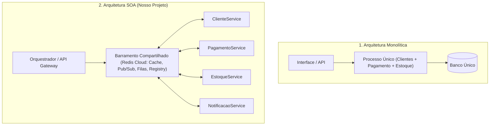
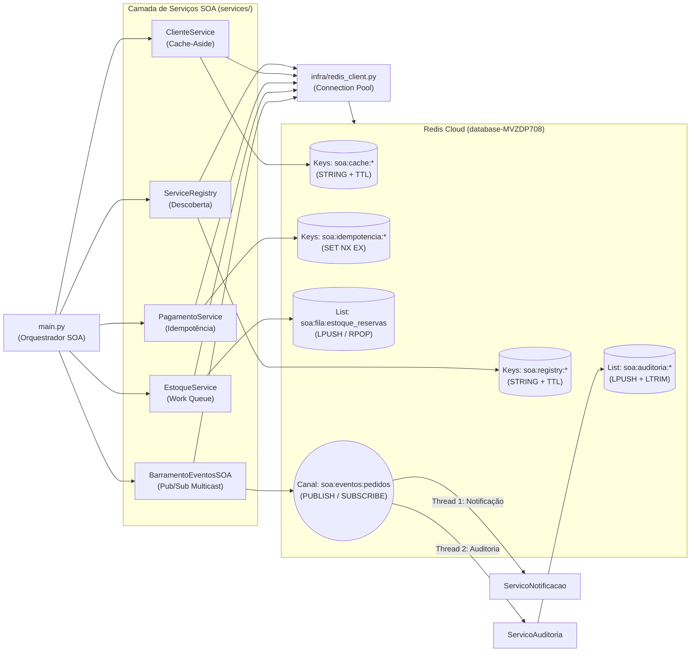
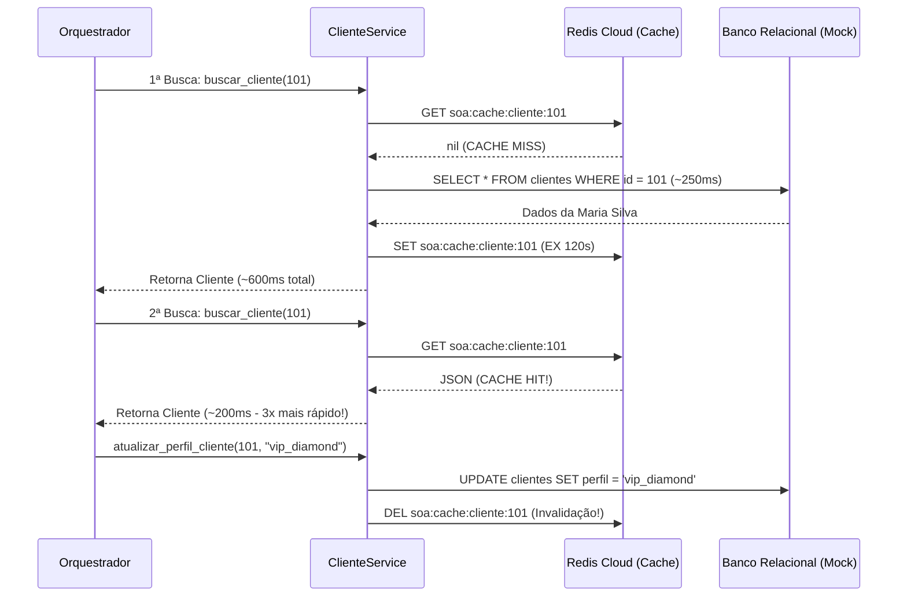

# Guia Completo: Arquitetura Orientada a Serviços (SOA) com Redis Cloud

Este documento explica em profundidade **como funciona a Arquitetura Orientada a Serviços (SOA)** na teoria e na prática, detalhando cada componente, dependência e padrão arquitetural implementado neste projeto.

---

## 1. O que é SOA (Service-Oriented Architecture) de fato?

**SOA (Arquitetura Orientada a Serviços)** é um estilo de arquitetura de software onde as funcionalidades de negócio são desenhadas como **serviços independentes, reutilizáveis e interoperáveis**, que se comunicam através de contratos bem definidos e de uma infraestrutura compartilhada de integração (frequentemente chamada de **ESB - Enterprise Service Bus** ou **Barramento de Serviços**).

Em vez de construir um único sistema monolítico onde Clientes, Pagamentos, Estoque e Notificações estão misturados no mesmo código e banco de dados, no SOA nós dividimos o domínio em **Serviços Autônomos**:

- **`ClienteService`**: Responsável apenas pelos dados cadastrais e perfil do cliente.
- **`PagamentoService`**: Responsável exclusivamente por autorizar cobranças e garantir que não haja duplicidade.
- **`EstoqueService`**: Responsável por reservar itens no armazém.
- **`NotificacaoService` & `AuditoriaService`**: Responsáveis por reagir a eventos de negócio sem bloquear o fluxo principal.

### Os 8 Princípios Fundamentais do SOA (e onde estão no nosso código)

| Princípio SOA | O que significa? | Onde está no nosso projeto? |
| :--- | :--- | :--- |
| **1. Contrato Padronizado** | Serviços trocam dados em formatos claros e previsíveis (JSON, XML, Protobuf). | Payloads JSON padronizados em todos os serviços (`pedido_id`, `cliente_id`, `evento`). |
| **2. Baixo Acoplamento (*Loose Coupling*)** | Um serviço não precisa conhecer a implementação interna de outro. | `BarramentoEventosSOA` publica no canal `soa:eventos:pedidos` sem saber quantos ou quais serviços estão ouvindo. |
| **3. Abstração** | A lógica interna (banco relacional, regras de cache) fica oculta do consumidor. | O orquestrador chama `cliente_service.buscar_cliente(101)` sem saber se veio do Redis ou do Banco de Dados. |
| **4. Reusabilidade** | Um mesmo serviço pode ser consumido por vários processos (Web, App, Faturamento). | `ClienteService` e `PagamentoService` são módulos reutilizáveis por qualquer fluxo. |
| **5. Autonomia** | Cada serviço controla sua própria lógica e ciclo de execução. | `EstoqueService` processa sua própria fila (`LPUSH`/`RPOP`) no seu ritmo. |
| **6. Ausência de Estado (*Statelessness*)** | Serviços não guardam sessão em memória local; o estado compartilhado fica externalizado. | Todo estado de cache, locks e filas está externalizado no **Redis Cloud**. |
| **7. Descoberta (*Discoverability*)** | Serviços podem ser localizados dinamicamente em um catálogo central. | Implementado em `ServiceRegistry` (`soa:registry:service:*`). |
| **8. Componibilidade (*Composability*)** | Serviços menores podem ser orquestrados para formar um processo de negócio completo. | `main.py` atua como Orquestrador SOA compondo o fluxo de Compra de ponta a ponta. |

---

## 2. Monolito vs. SOA vs. Microsserviços

Uma dúvida muito comum é a diferença entre **SOA** e **Microsserviços**:



- **Monolito**: Tudo roda junto. Se um módulo trava ou precisa escalar, todo o sistema sofre.
- **SOA**: Foca no **reuso corporativo** e em um **meio de integração inteligente e compartilhado** (no nosso caso, o **Redis Cloud** atuando como Barramento de Eventos, Fila, Cache Distribuído e Service Registry).
- **Microsserviços**: Evolução derivada do SOA que leva o isolamento ao extremo ("*dumb pipes, smart endpoints*"), onde cada microsserviço costuma ter infraestrutura totalmente segregada e evita compartilhar até mesmo camadas de cache.

---

## 3. Arquitetura Completa do Projeto

O diagrama abaixo ilustra como os módulos do nosso projeto interagem com o **Redis Cloud**:



---

## 4. Detalhamento Técnico dos Padrões Implementados

### 4.1. Infraestrutura e Connection Pool (`infra/redis_client.py`)
Abrir uma conexão TCP/TLS com um servidor em nuvem (AWS `us-east-1`) leva dezenas ou centenas de milissegundos devido ao *handshake* de rede.
- **Solução SOA**: Usamos `redis.ConnectionPool` na classe `RedisConnectionManager`.
- **Por que importa?**: As conexões ficam abertas e prontas para reuso entre todas as chamadas de serviços e *threads* (como os consumidores Pub/Sub), garantindo alta performance.

---

### 4.2. Padrão 1: Service Registry & Discovery (`services/service_registry.py`)
Em SOA, os serviços não devem ter IPs ou URLs fixos espalhados pelo código.
- **Como funciona**:
  1. Ao iniciar, cada serviço chama `registrar_servico()`, gravando na chave `soa:registry:service:<Nome>` um JSON com `versao`, `endpoint`, `status: UP` e um **TTL de 300 segundos**.
  2. Esse TTL funciona como um **Heartbeat (Batimento Cardíaco)**: se um serviço cair e parar de renovar seu registro, o próprio Redis apaga a chave automaticamente após o TTL!
  3. Quando o Orquestrador precisa chamar o serviço de pagamentos, ele consulta `descobrir_servico("PagamentoService")` para obter o endereço ativo.

---

### 4.3. Padrão 2: Cache-Aside e Invalidação (`services/cliente_service.py`)
Bancos de dados relacionais sofrem quando vários serviços consultam os mesmos dados repetidamente (como dados do cliente durante carrinho, checkout, pagamento e emissão de nota).



- **Por que invalidar (`DELETE`) em vez de apenas esperar o TTL?**
  Se o cliente mudou de `premium` para `vip_diamond`, outros serviços não podem ler dados defasados (*stale data*) pelos próximos 2 minutos. Ao deletar a chave no momento da escrita, forçamos a próxima leitura a buscar o dado fresco no banco.

---

### 4.4. Padrão 3: Idempotência e Lock Distribuído (`services/pagamento_service.py`)
Em sistemas distribuídos SOA, **a rede não é confiável**. Imagine que o Orquestrador enviou a requisição de cobrança de R$ 459,90, o `PagamentoService` cobrou o cartão, mas a resposta de confirmação caiu no meio do caminho por *timeout*. O Orquestrador vai tentar enviar a mesma cobrança de novo (*retry*).
- **O Problema**: Sem idempotência, o cliente seria cobrado duas vezes!
- **A Solução no Redis**:
  Usamos o comando atômico:
  ```python
  client.set(chave_lock, json.dumps(recibo), nx=True, ex=300)
  ```
  - `nx=True` (*Not Exists*): O Redis garante atomicamente que a chave **só será gravada se ainda não existir**.
  - `ex=300`: Expira o token após 5 minutos.
  - Na 1ª chamada, `set(..., nx=True)` retorna `True` e processa o pagamento.
  - Na 2ª chamada (retentativa com o mesmo `token_idempotencia`), o Redis retorna `None`/`False` imediatamente, e o serviço apenas devolve o recibo original sem cobrar novamente!

---

### 4.5. Padrão 4: Work Queue / Fila Assíncrona (`services/estoque_service.py`)
Nem toda tarefa precisa acontecer de forma síncrona enquanto o usuário espera na tela. Reservar itens físicos no galpão pode levar tempo.
- **Como funciona**:
  - **Produtor**: Usa `LPUSH soa:fila:estoque_reservas <json>` para empilhar pedidos na fila do Redis.
  - **Consumidor (Worker)**: Usa `RPOP soa:fila:estoque_reservas` para retirar o pedido mais antigo da fila (**FIFO** — *First-In, First-Out*).
- **Vantagem SOA (Desacoplamento Temporal)**: Se o `EstoqueService` estiver em manutenção por 10 minutos, os pedidos continuam sendo empilhados na lista do Redis sem perda de dados. Quando o serviço volta, ele processa toda a fila acumulada.

---

### 4.6. Padrão 5: Barramento de Eventos Pub/Sub (`services/eventos_service.py`)
Qual a diferença entre a **Fila (List)** do item anterior e o **Pub/Sub**?

| Característica | Fila de Trabalho (`LPUSH` / `RPOP`) | Pub/Sub (`PUBLISH` / `SUBSCRIBE`) |
| :--- | :--- | :--- |
| **Modelo de Entrega** | **1 para 1** (Apenas 1 worker consome cada item) | **1 para N (Broadcast/Multicast)** (Todos os assinantes recebem uma cópia) |
| **Persistência** | **Sim** (Fica salvo na lista até alguém dar `RPOP`) | **Não (Fire-and-Forget)** (Só recebe quem estiver conectado no momento do envio) |
| **Caso de Uso SOA** | Processamento de tarefas pesadas (Baixa de estoque, geração de PDF) | Notificação de eventos de domínio para múltiplos sistemas interessados |

No arquivo `services/eventos_service.py`, iniciamos **2 threads em background** antes de publicar os eventos:
1. **`ServicoNotificacao`**: Escuta o canal `soa:eventos:pedidos` e dispara e-mail/push para o cliente.
2. **`ServicoAuditoria`**: Escuta o mesmo canal simultaneamente e grava o evento na lista histórica `soa:auditoria:historico_eventos` usando `LPUSH` + `LTRIM` (mantendo sempre os últimos 20 eventos).

---

## 5. Dependências do Projeto (`requirements.txt`)

O projeto utiliza bibliotecas enxutas e padrão de mercado:

1. **`redis>=5.0.0` (`redis-py`)**:
   - Cliente oficial do Redis para Python.
   - Fornece suporte nativo a `ConnectionPool`, comandos atômicos (`SET NX EX`, `INCR`), estruturas de listas (`LPUSH`, `RPOP`, `LRANGE`, `LTRIM`) e clientes dedicados de `PubSub`.
   - Configurado com `decode_responses=True` para converter automaticamente os `bytes` retornados pelo Redis em `str` do Python.

2. **`python-dotenv>=1.0.0`**:
   - Carrega variáveis sensíveis do arquivo `.env` (`REDIS_HOST`, `REDIS_PORT`, `REDIS_PASSWORD`, `REDIS_USER`) para `os.environ`.
   - Segue a metodologia **Twelve-Factor App**, separando completamente o código-fonte das credenciais de ambiente.

3. **Bibliotecas Nativas do Python**:
   - `threading`: Execução concorrente dos serviços consumidores do Pub/Sub em tempo real.
   - `json`: Serialização e desserialização dos contratos de mensagem SOA.
   - `time` e `datetime`: Medição de latência em milissegundos (`perf_counter`) e carimbos de tempo ISO-8601.
